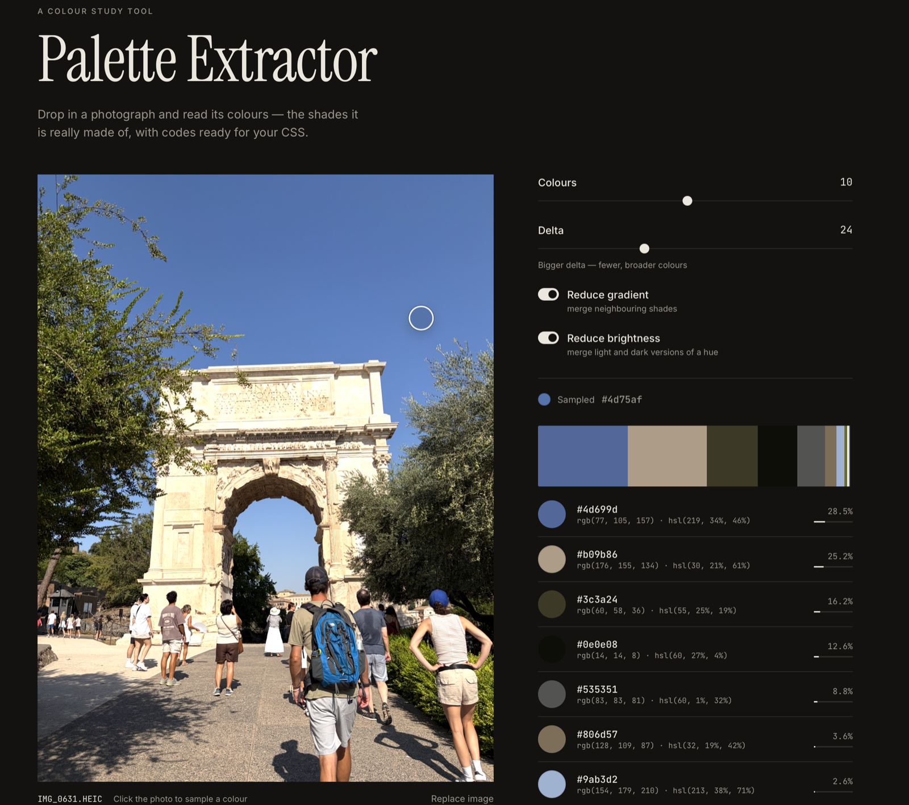

# Palette Extractor

A web app built with **Python, Flask and NumPy** that finds the most common colours in an image. Upload a photo and get its palette with HEX, RGB and HSL codes, ready to copy into your CSS or design tool.



## Features

- **Top colours of any image**: choose how many colours (1–20) and how fine the grouping is (`delta`). Each colour shows its share of the image.
- **Exact codes**: the HEX value is the real average colour of the pixels in a group, not the centre of a rounding bucket.
- **Reduce gradient**: merges neighbouring shades of a smooth transition, such as a sky that fades from light to dark blue.
- **Reduce brightness**: merges light and dark versions of the same hue. Greys, black and white are kept apart, because they have no hue.
- **Live update**: sliders and switches recalculate the palette straight away, without uploading the image again.
- **Highlight on the photo**: hover over a colour to see where it appears in the image.
- **Colour picker**: hover over the photo to preview a colour and click to copy its HEX code.
- **Export**: copy the palette as CSS variables or JSON, or download it as a PNG card.
- **Readable pairs**: colour pairs from the palette that pass the WCAG contrast check for text (AA 4.5:1, AAA 7:1).
- **Many formats**: PNG, JPG, WebP, GIF, BMP and iPhone HEIC photos, up to 10 MB. Drag and drop or paste from the clipboard.
- **Works without JavaScript** as a plain form, and has an automatic light and dark theme.
- **Nothing is stored**: images are processed in memory and never saved on the server.

## How it works

1. The image is rotated according to its EXIF data and scaled down to 300 × 300 px. More pixels hardly change the result but take longer to count.
2. Every channel is rounded to steps of `delta` (24 by default), so close shades fall into the same "bucket".
3. Each colour is packed into one integer (`r << 16 | g << 8 | b`), and `np.unique(..., return_counts=True)` counts the buckets in one vectorised call.
4. Optional merging walks through the buckets from the most to the least common and joins each one to the first similar colour that is already kept:
   - *gradient*: every channel differs by at most `delta`;
   - *brightness*: the colours look the same after scaling their brightest channel to 255.
5. The app keeps a label for every pixel, so it can draw a mask that highlights where each colour appears.

## Why JavaScript

**Python finds the colours, and JavaScript makes the page interactive.** Python runs on the server, while the browser can only run JavaScript. So everything that should react instantly, without reloading the page, lives in `static/app.js`:

- **Live update**: when a slider or switch changes, JavaScript sends the image and the new settings to `/palette` with `fetch` and puts the returned HTML on the page. The calculation itself still happens in NumPy on the server. Requests are debounced (180 ms), and an outdated request is cancelled with `AbortController`, so an old result can never overwrite a newer one.
- **Uploading**: drag and drop, paste from the clipboard and an instant preview. If the browser cannot show the file itself (HEIC outside Safari), it asks the server for a JPEG preview.
- **Highlight on the photo**: Python creates a mask for each colour, and JavaScript lays it over the photo when you hover over that colour.
- **Colour picker**: the photo is drawn on a hidden `<canvas>`, and the pixel under the cursor is read in the browser, without the server.
- **Copy and export**: HEX codes, CSS variables and JSON go to the clipboard. The PNG palette card is drawn on a `<canvas>` and downloaded.

JavaScript is an enhancement, not a requirement (*progressive enhancement*). With JavaScript turned off, the page works as a plain form: choose a file, press "Extract colours" and the server returns the full page with the palette. That button is hidden when JavaScript is on, because the palette updates by itself.

## Python tools and techniques used

| Tool | What it does in this project |
|---|---|
| **NumPy** | Rounding, packing colours into integers, `np.unique` with counts and inverse indices, `np.add.at` for per-group sums, masks for the highlight |
| **Pillow** | Reading images, `ImageOps.exif_transpose`, thumbnails, PNG/JPEG encoding of masks and previews |
| **pillow-heif** | Reading HEIC photos from iPhone |
| **Flask** | Two views of the same result: a full page for the plain form and an HTML fragment for live updates with `fetch` |
| **Jinja2** | A shared `_result.html` partial used by both routes |
| **`dataclasses`** and **`colorsys`** | A `Color` class with `hex`, `hsl` and WCAG luminance properties |
| **`itertools.combinations`** | Checking every pair of colours for contrast |
| **`base64`** / **`io.BytesIO`** | Sending previews and masks as data URLs, without files on disk |
| **pytest** | Tests for the colour logic and the routes |

## Run locally

```bash
python3 -m venv venv
source venv/bin/activate
pip install -r requirements.txt
python3 app.py
```

Open http://127.0.0.1:5000

Run the tests:

```bash
pip install -r requirements-dev.txt
python3 -m pytest
```

## Routes

| Method | Route | Description |
|---|---|---|
| GET | `/` | The page |
| POST | `/` | Plain form upload, returns the full page with the result |
| POST | `/palette` | Returns only the result block, used by JavaScript for live updates |

Form fields: `image` (file), `n_colors`, `delta`, `reduce_gradient`, `reduce_brightness` (checkboxes).

## Project structure

```
color-palette-extractor/
├── app.py              # Flask routes, upload checks, masks and previews
├── palette.py          # Colour extraction with NumPy, Color class, WCAG contrast
├── templates/
│   ├── index.html      # The page
│   └── _result.html    # Palette, export and readable pairs
├── static/
│   ├── style.css
│   └── app.js          # Live update, drag and drop, highlight, colour picker, export
├── tests/
├── docs/screenshot.png
├── requirements.txt
└── requirements-dev.txt
```

## Credits

A portfolio project from *100 Days of Code: The Complete Python Pro Bootcamp*. It was inspired by [Flat UI Colors](https://flatuicolors.com/) and the [Image Color Extract](http://www.coolphptools.com/color_extract) PHP tool.
